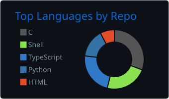
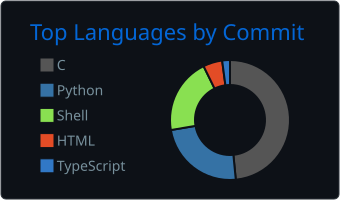
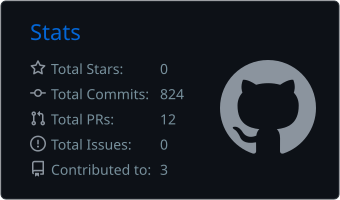
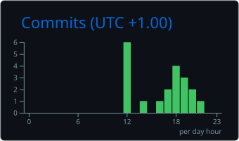

<h1 align="center">Hi 👋, I'm Favour Ogidi</h1>
<h3 align="center">Frontend Developer · Python Instructor · Computer Science Graduate</h3>

  

<table>
  <tr>
    <td valign="middle" width="55%">
      <ul>
        <li>🔭 Frontend Developer at <b>Tobams Group</b>, turning Figma designs into real web pages</li>
        <li>🎓 B.Tech Computer Science, Federal University of Technology Owerri (2025)</li>
        <li>💬 Ask me about <b>Python, C, Bash, React / Next.js and WordPress</b></li>
        <li>📫 <a href="mailto:1ogidifavour@gmail.com">1ogidifavour@gmail.com</a></li>
      </ul>
    </td>
    <td valign="middle" align="center" width="45%">
      
    </td>
  </tr>
</table>

<h3 align="left">Connect with me:</h3>

### 🧰 Tech stack

  

### 💼 Experience highlights

- **Frontend Developer Intern**, Tobams Group (2026 – present): Figma-to-web conversion, plus leading and joining product feature workshops.
- **Graduate Trainee**, Pedulek Energy Group (2025 – present): led the redevelopment of the company website, improving structure, performance and maintainability.
- **Web Developer & CMS Specialist**, Freelance (2023 – 2025): responsive WordPress and Next.js sites, custom themes and plugins, SEO and mobile improvements.
- **Programming Instructor (Python)**, Genius and Gurus Secondary School (2024 – 2025): designed a project-based curriculum taking students from zero to project-ready.
- **AI & Research Projects** (2024 – 2025): deep learning research on depression prediction in women using text and tabular data, written up with IEEE and APA referencing.

### 📊 Languages I actually use

  
  

### 📈 GitHub stats

  
  

  

  

